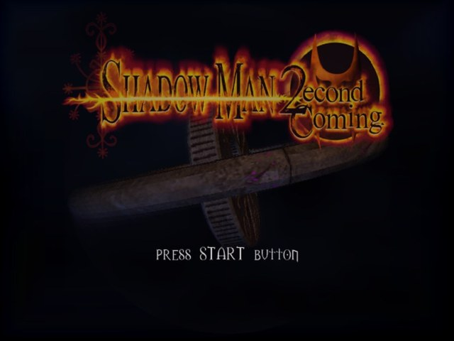
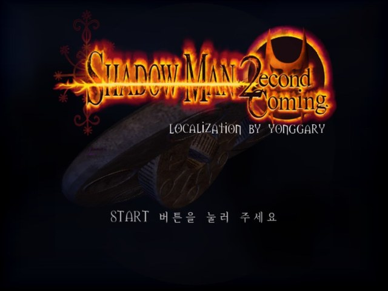
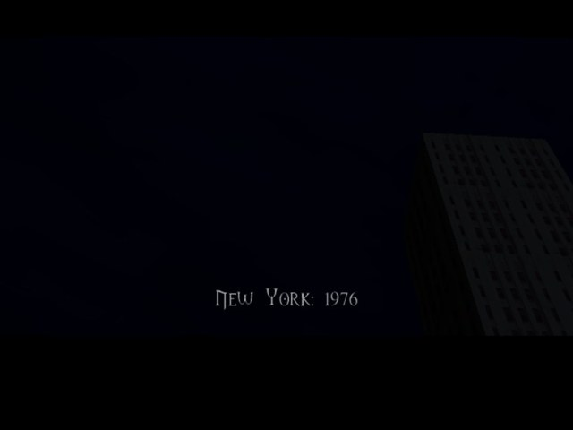
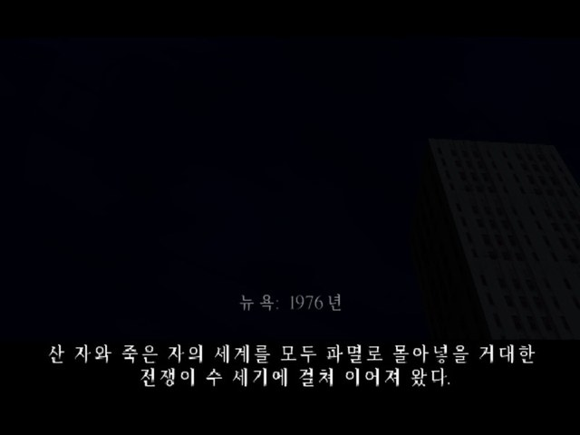
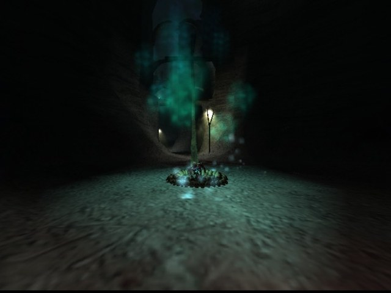
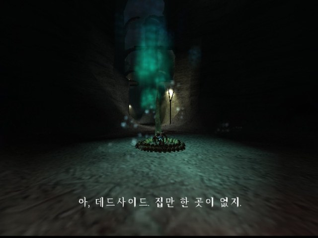
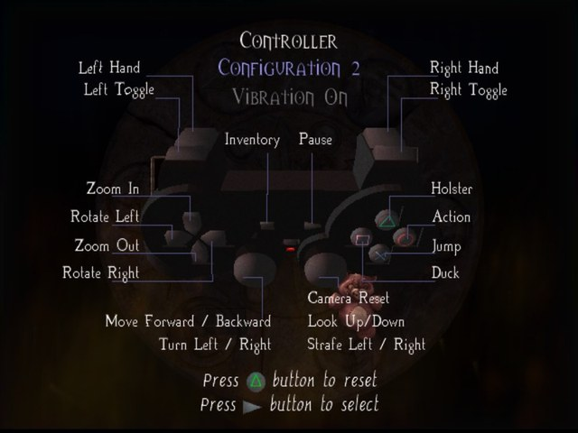
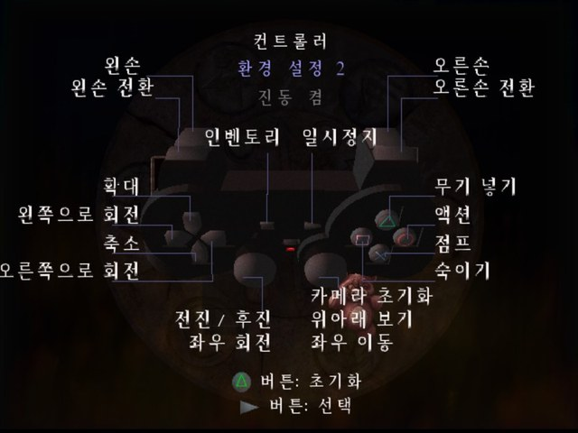
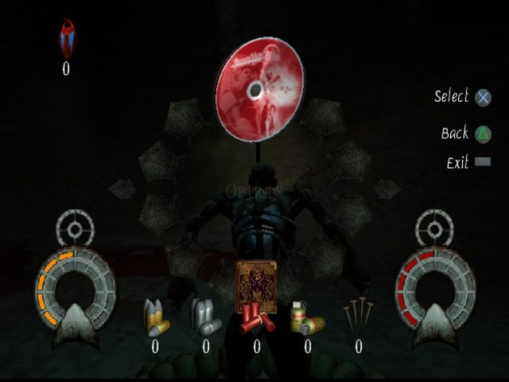
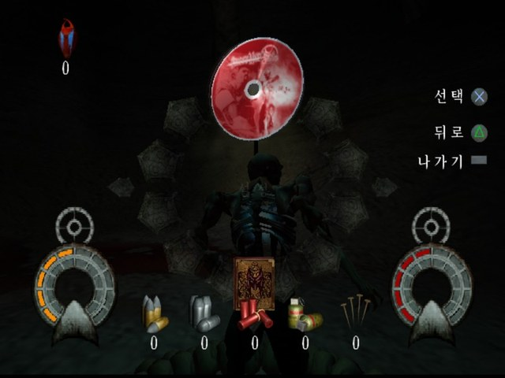

# 섀도우맨 2econd Coming 한글패치 (PS2 북미판)

**Shadow Man: 2econd Coming** PS2 북미판 **SLUS-20413** 한글패치입니다.

> 본 한글패치는 개인이 제작한 비공식·비상업적 팬 한글패치입니다. — by **Yonggary6425 (용가리)**
> 게임 이미지(bin/cue)는 포함되어 있지 않습니다. 직접 소유한 원본으로만 사용해 주세요.

| 원본 북미판 | 한글패치 |
|---|---|
|  |  |
|  |  |
|  |  |
|  |  |
|  |  |

(PCSX2 2.8.2 의 스크린샷 기능으로 찍은 화면을 640×480 으로 줄인 것입니다. 원본과 한글판을 같은 입력 순서로 진행했습니다.)

---

## 한글화 범위

- **컷신 자막**: 33개 장면 전부 (내용이 같은 중복 파일 포함 53개 파일). 줄 수와 표시 순서는 원본 그대로입니다.
- **메뉴·시스템 문구**: 메뉴, 옵션, 조작 설명, 메모리 카드 안내, 지역명, 아이템명 등 462줄, 회중시계 여정 요약
- **문서**: 그리무아르 앵페르날, 디컨의 메시지
- **그 밖의 문구**: 저작권 화면·로딩 화면 지명 등 실행 파일 안의 문구 14개, 크레딧 직책
- **원판에 없던 자막을 새로 추가**
  - 인트로 나레이션 4문장: 원판은 첫 컷신의 처음 약 38초 동안 자막 없이 나레이션만 나옵니다.
  - 게임 중 음성 대사 196줄: 마이크 173, 존티 11, 네티 2, 아스모데우스·모르테·부하 도발 10.
    원판에는 게임 플레이 중 대사에 자막을 띄우는 기능이 없어서, 음성이 재생되면 해당 대사의 한글을 화면 아래에 띄우고 음성 길이 + 0.6초 뒤에 지우도록 만들었습니다.
- **한글 출력 기능**을 새로 넣었습니다. 한글 글꼴 741자 (Noto Serif CJK KR / 본명조 Bold, SIL OFL 1.1)
- 타이틀 화면 `localization by yonggary` 표기, 크레딧 한글패치 문구

음성은 영어 그대로입니다. 그림으로 된 글자(타이틀 로고, 로딩 화면의 LOAD 등)는 바꾸지 않았습니다.
신음·기합처럼 말이 아닌 소리와 알아듣기 어려운 일부 보스 대사에는 자막을 넣지 않았습니다.

자세한 원본 비교는 [`docs/`](docs/) 의 PDF를 참고하세요.

---

## 준비물

- PS2 북미판 원본 **Shadow Man: 2econd Coming (USA)** / **SLUS-20413** (bin/cue, 1트랙)
  - `Shadow Man - 2econd Coming (USA).bin` — 크기 587,167,392 바이트, MD5 `b1f3a583d2e4afaf6cad325f16000ba0`
  - 크기와 MD5가 같은 원본에만 적용됩니다.
- Windows 10/11 (추가 설치 없음) 또는 Python 3.8 이상
- 빈 디스크 공간 약 600 MB

## 적용 방법

[Releases](../../releases) 에서 최신 `ShadowMan2_KOR_Patch_v*.zip` 을 받아 압축을 풉니다.

### A. Windows

1. **`Shadow Man - 2econd Coming (USA).bin`** 파일을 **`패치하기.bat`** 위에 끌어다 놓습니다.
2. 같은 폴더에 **`Shadow Man - 2econd Coming (USA) (Korean).bin`** 이 새로 생깁니다. (원본은 그대로 둡니다)
3. 같은 폴더에 원본 cue 가 있으면 **`Shadow Man - 2econd Coming (USA) (Korean).cue`** 도 만들어 줍니다.
4. `완료!` 가 나오면 성공입니다.
5. **PCSX2 에서는 만든 `(Korean).bin` 파일을 직접 여세요.** (PCSX2 2.8.2 에서는 원본도 cue 로는 열리지 않았습니다)

### B. Python (macOS / Linux)

```
python3 patch.py "Shadow Man - 2econd Coming (USA).bin"
```

> 패처는 원본 bin 에서 바뀌지 않은 부분을 읽어 오고, 달라진 섹터만 패치 데이터에서 채워 새 bin 을 만듭니다.
> 적용 전에 원본의 MD5를, 적용 후에 결과의 MD5(`4f74c75f315c8cf09aa369f468e4c87a`)를 검사합니다.
> 한글판 bin 은 원본보다 406,896 바이트 큽니다(번역 파일을 디스크 뒤쪽에 덧붙였기 때문).

## 주의

- **세이브 스테이트(즉석 저장)로 불러오면 이전 글자가 보일 수 있습니다.** 메모리 카드 세이브로 불러오거나 새로 시작해 주세요.
- 이전 패치본에 다시 적용하지 말고, 항상 **원본 bin** 에 적용해 주세요.
- 테스트 환경: PCSX2 2.8.2 (실기에서는 확인하지 않았습니다)

## 알려진 사항

- 실제 화면으로 확인한 범위는 저작권 화면, 타이틀, 메인 메뉴, 사운드·컨트롤러 설정, 인트로 나레이션 자막과 이어지는 컷신 자막, 데드사이드 시작 지점의 음성 자막, 인벤토리, 일시정지입니다.
- 이후 스테이지의 컷신 자막과 음성 자막, 문서 페이지, 회중시계 여정 요약, 메모리 카드 저장 화면, 엔딩 크레딧은 게임 안에서 확인하지 못했습니다.
- 음성 자막 196줄 중 게임 안에서 직접 확인한 것은 데드사이드 시작 대사입니다. 나머지도 같은 방식으로 나오도록 만들었습니다.
- 한글 글꼴에 없는 글자는 표시되지 않습니다.

## 구성 파일

```
patcher/
  patch.ps1      적용기 본체 (Windows PowerShell 기본 기능)
  patch.py       Python 적용기
  sm2_kor.bin    한글패치 데이터
  (패치하기.bat  드래그 앤 드롭 실행 파일, README.txt 사용법 - Releases 의 zip 에만 들어 있습니다)
docs/
  원본 비교 PDF, screenshots/
licenses/
  Noto Serif CJK 글꼴 라이선스 (SIL OFL 1.1)
```

## 크레딧

- 한글화·패처 제작: **Yonggary6425 (용가리)**
- 번역·한글 출력 도구 제작 보조: Claude (Anthropic)
- 한글 글꼴: Noto Serif CJK KR (본명조) Bold (© Adobe, SIL Open Font License 1.1, `licenses/`)
- 원작: Shadow Man: 2econd Coming © 2002 Acclaim Entertainment. 모든 권리는 원저작권자에게 있습니다.

## 버그 제보

오역·오탈자·표시 문제는 [Issues](../../issues) 에 장면(스테이지·상황)과 스크린샷을 함께 올려 주세요.
